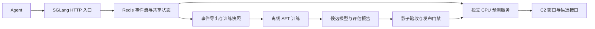

# TimePredictModel

**面向 SGLang 工具调用的回返时间预测与训练系统。**

TimePredictModel 从 SGLang 的 OpenAI 兼容接口采集工具调用事件，关联后续工具结果请求，使用结构化特征与 XGBoost AFT 学习回返时间分布。在线服务根据已经等待的时间，输出剩余时间分位数、窗口内回返概率及期望等待成本，为上层调度器提供决策输入。

项目面向 Linux 服务器训练与部署。预测在独立 CPU 服务中执行，XGBoost 不进入 SGLang GPU 推理进程。本仓库包含源码、固定版本补丁、Agent 示例和部署工具，不包含预训练模型或可直接用于生产的数据集。

| 项目 | 说明 |
|---|---|
| SGLang 基线 | `v0.5.19` · [`0bcd822`](https://github.com/sgl-project/sglang/tree/0bcd822377da7b5718e674eaf9c870d349424dd1) |
| 建模方法 | 结构化特征 + XGBoost `survival:aft`，对数正态分布 |
| 服务依赖 | Python 3.11+、Redis 7.0+、chrony |
| 输出接口 | 认证 HTTP API、版本化候选通知、全量快照 |
| 当前范围 | 调用采集、样本关联、离线训练、影子预测和窗口候选 |
| 范围之外 | C2 密度评分、KV 节点映射、实际预加载及缓存收益评估 |

## 导航

- [系统设计](#系统设计)
- [安装与接入](#安装与接入)
- [数据准备与训练](#数据准备与训练)
- [模型发布](#模型发布)
- [接口与消费约定](#接口与消费约定)
- [服务器验收](#服务器验收)
- [运行边界与验证状态](#运行边界与验证状态)
- [仓库结构](#仓库结构)

## 系统设计



### 预测目标

$$
T = t_{\mathrm{return}} - t_{\mathrm{out}}
$$

- **发出时刻**：完整非流式 JSON 响应或流式 `[DONE]` 标记提交给 ASGI `send` 之前。发送成功后异步发布事件，发送异常单独记录。
- **回返时刻**：携带匹配 `tool_call_id` 的续接请求进入 SGLang 时。认证和请求校验成功后提交关联事件，但使用最初的入口时间。

因此，标签包含网络、工具执行和 Agent 编排耗时，不包含续接请求进入 SGLang 后的排队与推理时间。发出边界表示服务端提交发送，不等同于客户端接收完成。

模型在工具发出后预测一次并缓存分布参数。等待期间通过条件生存分布计算剩余时间：

$$
P(R\leq h\mid T>a)=1-\frac{S(a+h)}{S(a)}
$$

其中，$a$ 为已经等待的秒数，$S$ 为总回返时间的生存函数。接口同时返回剩余 P50/P90、$E[R]$ 和 $E[\min(R,H)]$，分别用于时机判断和成本估计。

### 调用协议

每个 `(tenant, workflow_id, agent_id)` 同时只允许一轮待回返调用，每轮只支持一个工具。客户端设置 `n=1`、`parallel_tool_calls=false`，收到完整响应后再执行工具。

| 请求头 | 约定 |
|---|---|
| `Authorization` | SGLang 已配置的 Bearer API key |
| `X-Workflow-ID` | 当前业务工作流实例标识 |
| `X-Agent-ID` | 工作流中的 Agent 实例标识 |
| `X-Request-ID` | 逻辑请求标识；传输重试时保持不变 |

续接请求使用 OpenAI 协议已有的 `tool_call_id` 关联结果。只有最新续接轮次中匹配的工具结果才闭合记录；单纯再次收到同一 Agent 的请求不足以认定回返。业务 ID 用于关联与分组，不进入模型特征。

## 安装与接入

以下命令在 Linux shell 中执行。`/path/to/...`、模型名、parser 名、地址和密钥均需替换为实际配置。SGLang 的 GPU 依赖按其官方说明单独安装。

### 1. 安装预测器

```bash
git clone https://github.com/Crystalclear9/TimePredictModel.git
cd TimePredictModel
uv sync --locked --python 3.11
```

在运行 SGLang 的 Python 环境中同样安装本包，使补丁能够导入采集适配层：

```bash
python -m pip install /path/to/TimePredictModel
```

### 2. 应用固定版本补丁

```bash
git -C /path/to/sglang checkout 0bcd822377da7b5718e674eaf9c870d349424dd1
git -C /path/to/sglang apply --check /path/to/TimePredictModel/patches/sglang-v0.5.19.patch
git -C /path/to/sglang apply /path/to/TimePredictModel/patches/sglang-v0.5.19.patch
```

补丁接入 `http_server.py`、`serving_base.py` 和 `serving_chat.py`。每个 SGLang 副本使用一个 HTTP/tokenizer worker；多入口通过独立副本部署，副本内部仍可使用 tensor parallel 多 GPU。

### 3. 配置认证与共享状态

SGLang 入口需要以下环境变量：

```bash
export TIMEPREDICT_REDIS_URL='redis://private-redis:6379/0'
export TIMEPREDICT_PREFIX='timepredict'
export TIMEPREDICT_SOURCE='ingress-host-01'
export SGLANG_API_KEY='replace-with-your-sglang-key'
```

同一业务命名空间的入口使用相同 SGLang key、Redis 地址和 prefix；不同入口使用可区分的 source 名。服务端根据已认证 key 的 SHA-256 确定 tenant。密钥轮换会改变该命名空间，应在旧轮次结束后切换。

预测服务通过 JSON 文件将内部访问令牌映射到 tenant，例如 `/etc/timepredict/tokens.json`：

```json
{
  "replace-with-your-internal-token": "sha256-of-your-sglang-api-key"
}
```

右侧填写 SGLang key 的实际 SHA-256 十六进制摘要。可在已设置 `SGLANG_API_KEY` 的 shell 中计算：

```bash
python -c 'import hashlib, os; print(hashlib.sha256(os.environ["SGLANG_API_KEY"].encode()).hexdigest())'
```

### 4. 启动采集链路

在 SGLang 环境启动入口：

```bash
python -m sglang.launch_server \
  --model-path /models/tool-capable-model \
  --tool-call-parser your-model-parser \
  --api-key "$SGLANG_API_KEY" \
  --host 0.0.0.0 --port 30000
```

在本项目环境启动预测服务。首次采集可以不提供模型，关联与标签采集仍正常运行：

```bash
uv run timepredict serve \
  --redis-url "$TIMEPREDICT_REDIS_URL" --prefix timepredict \
  --tokens-file /etc/timepredict/tokens.json \
  --host 0.0.0.0 --port 8098 --window-h 2
```

若未指定 `--host`，预测服务默认仅监听 `127.0.0.1`。跨机器部署需要显式配置监听地址，并确保入口和预测服务都能读取已同步的 chrony 状态。

运行 Agent 示例：

```bash
export TIMEPREDICT_API_KEY='replace-with-your-internal-token'
uv run python examples/agent_client.py \
  --model your-model --sglang http://ingress:30000 \
  --predictor http://predictor:8098 --stream
```

移除 `--stream` 可切换为非流式。示例使用固定演示执行器，只用于说明接入方式；采集训练数据时应替换为真实工具。Agent 等待期间每 5 秒发送心跳，工作流完成发送 `terminate`，异常结束发送 `cancel` 和 `terminate`。

## 数据准备与训练

训练需要**真实测量且正确关联的工具回返时间**。只有工具调用文本、没有相应延迟标签的公开语料，不能直接作为本项目的有标签训练集。样本字段、删失规则与采集建议见 [训练数据指南](DATASET.md)。

### 导出、截取与校验

在事件已进入历史流后导出数据，选择明确的 UTC Unix 秒作为截取边界：

```bash
uv run timepredict export \
  --redis-url "$TIMEPREDICT_REDIS_URL" --prefix timepredict \
  --output events.jsonl

# 将占位值替换为本次数据快照的实际截取时间。
uv run timepredict snapshot \
  --events events.jsonl --cutoff ACTUAL_UTC_UNIX_SECONDS \
  --output samples.jsonl

uv run timepredict check-data --data samples.jsonl
```

`check-data` 检查标签、重复样本、workflow 元数据和时间划分，输出各集合的精确/删失样本数及数据摘要。真实回返标签为 `[T,T]`；截取时仍被完整观察的等待记录为 `[a,null]`，其中 `null` 表示右删失上界。取消、失联和采集缺口不作为普通删失样本。

### 训练候选模型

```bash
uv run timepredict train --data samples.jsonl --output candidates \
  --threads 16 --rounds 500 --data-kind observed
```

线程数由训练服务器资源配额决定。`--data-kind` 应如实标记数据来源；合成数据使用 `synthetic`，不能通过正式发布门禁。

| 训练配置 | 默认值或规则 |
|---|---|
| 目标函数 / 分布 | `survival:aft` / `normal` |
| 树方法 / 设备 | `hist` / CPU |
| 最大深度 / 学习率 | 4 / 0.05 |
| 训练轮数 / 提前停止 | 默认最多 500 轮 / 30 轮 |
| σ 候选 | 0.25、0.5、1、1.5、2 |
| 模型选择 | 验证集 AFT 负对数似然 |
| 数据划分 | 按 workflow 开始时间约 70% / 15% / 15%；跨分界工作流隔离 |
| 特征词典 | 仅使用训练集建立，最多 4096 个结构字段，在线冻结 |

训练产物位于 `candidates/<version>/`，包含树模型、特征词典、σ、最佳迭代、依赖版本、校验摘要和评估报告。报告覆盖删失似然、分位数覆盖率、窗口校准及经验基线比较。整工具留出实验可通过 `--holdout-tool TOOL_NAME` 单独运行。

## 模型发布

模型生命周期分为**候选训练、影子验收、正式发布**三个阶段。训练不会修改正式服务的 `CURRENT` 指针。

### 影子运行

在独立验收部署运行候选模型。验收 SGLang 入口与预测服务必须使用同一个验收 prefix；同一 prefix 的 worker 共享选主租约，不应用于同时运行不同模型。

```bash
uv run timepredict serve \
  --redis-url "$TIMEPREDICT_REDIS_URL" --prefix timepredict-acceptance \
  --tokens-file /etc/timepredict/tokens.json \
  --host 0.0.0.0 --port 8098 --window-h 2 \
  --shadow-candidate candidates/VERSION
```

影子模式计算分布，但返回 `shadow=true`、`in_window=false`，不会生成可执行的入窗候选。

### 门禁与正式加载

完成服务器验收后，用对应模型版本的证据执行发布：

```bash
uv run timepredict promote \
  --candidate candidates/VERSION --serving-dir models \
  --evidence server-acceptance.json --policy deploy/gate-policy.json
```

[发布策略](deploy/gate-policy.json) 检查数据来源、删失支持、校准、基线比较、服务器功能和性能证据。阈值属于显式工程策略，应在实验前确定。检查失败不修改 `CURRENT`；通过后保存模型、原始证据和策略，再原子切换版本指针。

正式服务在前述 `serve` 命令上增加 `--models models`。服务每 5 秒检查模型更新，加载失败时保留上次成功版本；已有等待轮次继续使用其缓存的原分布参数。

## 接口与消费约定

所有内部 API 均要求 `Authorization: Bearer <internal-token>`。

| 接口 | 作用 |
|---|---|
| `GET /internal/window?H_seconds=2` | 当前全量快照：业务键、版本、状态、已等待时间、剩余分位数、概率和期望成本 |
| `GET /internal/notices?after=0-0` | 根据 Redis stream cursor 获取候选更新和移除事件 |
| `POST /internal/lifecycle/heartbeat` | 更新 Agent 存活状态；请求体包含 `workflow_id` 和 `agent_id` |
| `POST /internal/lifecycle/cancel` | 取消指定 Agent 的等待轮次；请求体包含 `workflow_id` 和 `agent_id` |
| `POST /internal/lifecycle/terminate` | 终止整个工作流；请求体包含 `workflow_id` |
| `GET /internal/health` | 模型版本、时钟、处理器新鲜度、来源、队列、延迟及 CAS 指标 |

查询示例：

```bash
curl --fail --get 'http://predictor:8098/internal/window' \
  --header "Authorization: Bearer $TIMEPREDICT_API_KEY" \
  --data-urlencode 'H_seconds=2'
```

消费者首先读取全量快照，之后从返回的 `notice_cursor` 继续消费通知。只在 `status=ready`、非影子模式且剩余 P50≤H 时入窗；`unknown` 必须保留为不确定状态。

[CandidateCache](src/timepredict/candidates.py) 提供版本过滤和本地过期处理。调用 `snapshot` / `notice` 时传入实测 `roundtrip_seconds`，扣除网络耗时，并使用单调时间执行 `valid_for_seconds`。每个缓存使用固定 H，通知中的 H 由服务的 `--window-h` 决定。

处理器超过 2 秒未刷新，或来源/Agent 超过 30 秒失去观察时，接口降级为 unknown。消费端不能仅依赖下一条移除通知来撤销过期候选。健康接口的 `degraded` 状态仍使用 HTTP 200，应检查响应体。

## 服务器验收

正式发布前需要在目标部署上验证真实 SGLang 流式/非流式请求、跨入口关联、校时和故障切换，并测量入口开销、预测可用延迟、队列积压与吞吐变化。

| 工具 | 验证内容 |
|---|---|
| [verify_failover.py](deploy/verify_failover.py) | 受控停止 leader，确认备用 worker 接管并继续消费事件 |
| [benchmark_server.py](deploy/benchmark_server.py) | 完整单工具往返、交替入口、闭合验证、延迟与基准吞吐比较 |
| [benchmark_scale.py](deploy/benchmark_scale.py) | 状态规模、CAS 延迟/重试、窗口计算和离线评估资源消耗 |

<details>
<summary>服务器验收命令</summary>

在独立验收部署上执行。故障演练中的停止命令由部署方明确提供，完成后自行恢复旧副本：

```bash
uv run python deploy/verify_failover.py \
  --before http://leader:8098 --after http://standby:8098 \
  --redis-url "$TIMEPREDICT_REDIS_URL" --prefix timepredict-acceptance \
  --stop-command '["ssh","leader-host","sudo","systemctl","stop","timepredict-acceptance"]' \
  --output failover.json
```

切换完成后，压测地址指向新的 leader：

```bash
uv run python deploy/benchmark_server.py \
  --baseline http://baseline-a:30000 http://baseline-b:30000 \
  --instrumented http://instrumented-a:30000 http://instrumented-b:30000 \
  --predictor http://current-leader:8098 \
  --redis-url "$TIMEPREDICT_REDIS_URL" --prefix timepredict-acceptance \
  --failover-evidence failover.json --requests workload.jsonl \
  --output server-acceptance.json
```

`workload.jsonl` 每行是能产生一个工具调用的 OpenAI chat 请求。两组部署使用相同硬件、模型、入口数量和请求参数。脚本读取 `SGLANG_API_KEY`、`TIMEPREDICT_API_KEY`；工具执行使用固定延时与结果，因此输出只作为验收证据，不作为训练数据。

规模预算由部署方确定，以下数值仅为命令示例：

```bash
uv run python deploy/benchmark_scale.py \
  --redis-url "$TIMEPREDICT_REDIS_URL" \
  --sizes 100 1000 5000 --events 1000 --training-rows 100000 \
  --max-mutate-p99 0.1 --max-state-bytes 64000000 \
  --max-window-seconds 0.1 --output scale-acceptance.json
```

</details>

首版性能目标为入口新增 P99≤2 ms、吞吐下降≤1%。这些是待验证目标，不是已测得的结果。滚动直方图应在独立验收副本上采集；容量评估还需覆盖真实参数大小和保留周期内的状态积累。

## 运行边界与验证状态

| 方面 | 当前约定 |
|---|---|
| 故障降级 | Redis 或预测服务不可用不阻塞 SGLang 正常处理请求；采集缺口单独记录 |
| 原子性 | 每个 prefix 由租约选举 worker；状态、版本和通知通过 Redis CAS 更新，旧持有者无法继续写入 |
| 计时 | 同启动进程优先单调时间；跨机器使用 UTC，校时误差之和不超过 5 ms |
| 数据保留 | 幂等范围 7 天，闭合记录热保留 1 小时；事件和历史流不自动裁剪，需归档后管理保留周期 |
| 扩展性 | 每个 namespace 使用一个 CAS 状态文档，当前没有自动分片；支持规模以服务器实测为准 |
| 不支持的输入 | 多工具、参数不完整、超出输入边界、未知工具和不可用时钟不会生成有效预测 |

固定版本的 Qwen parser 在单个增量块包含完整工具对象的边界情况下，可能只输出工具名。适配层将此类不完整参数标记为未覆盖。

开发阶段已在 WSL/Linux 完成 70 项功能测试、真实 Redis 链路和固定版本补丁检查。当前仓库保留精简源码，未保留该测试套件及其产物。真实 GPU 服务、跨主机校时、真实数据精度和目标服务器性能仍需按上述流程验收；本项目尚未验证对 KV 决策的实际收益。

## 仓库结构

```text
TimePredictModel/
├── src/timepredict/       # 采集、状态、特征、训练、预测与发布
├── patches/              # 固定版本 SGLang 补丁及上游摘要
├── examples/             # Agent 接入示例
├── deploy/               # 服务配置、训练入口和验收工具
├── DATASET.md            # 数据采集与样本格式
├── pyproject.toml        # 包配置与 CLI 入口
└── uv.lock               # 生产依赖锁定
```

部署模板包括 [systemd 服务](deploy/timepredict.service)、[Redis 配置](deploy/redis.conf)、[训练入口](deploy/train.sh) 和 [Dockerfile](deploy/Dockerfile)。模板中的路径、账户及资源参数应按实际服务器配置。
